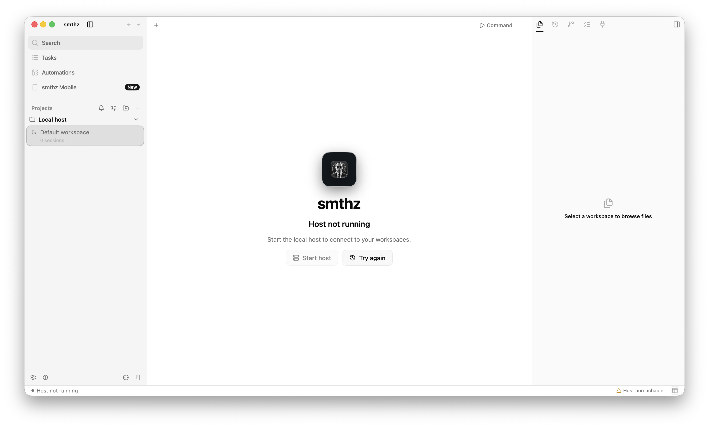
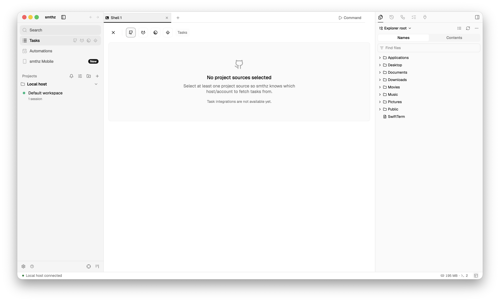
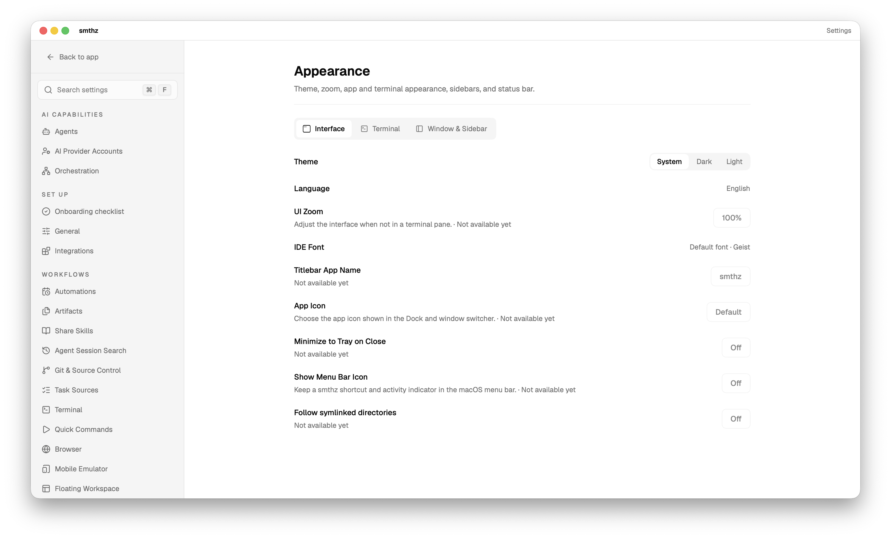
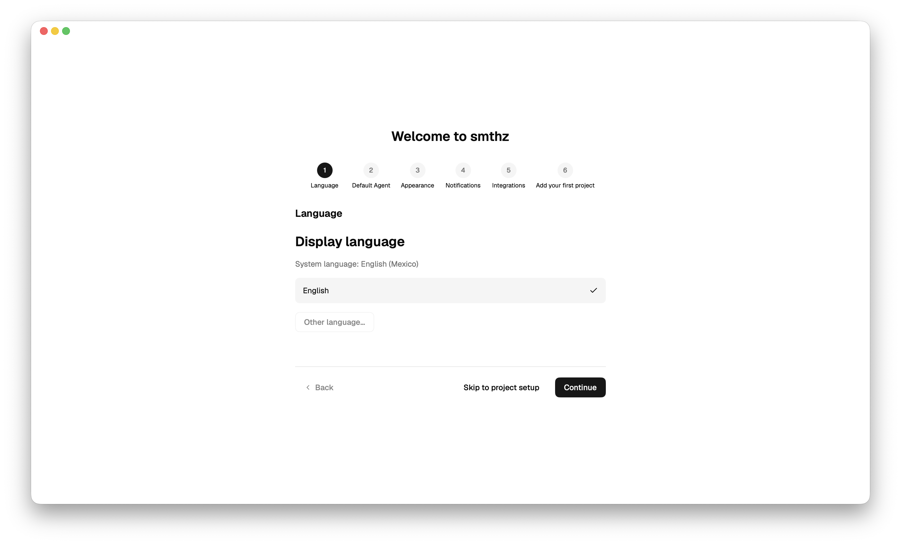
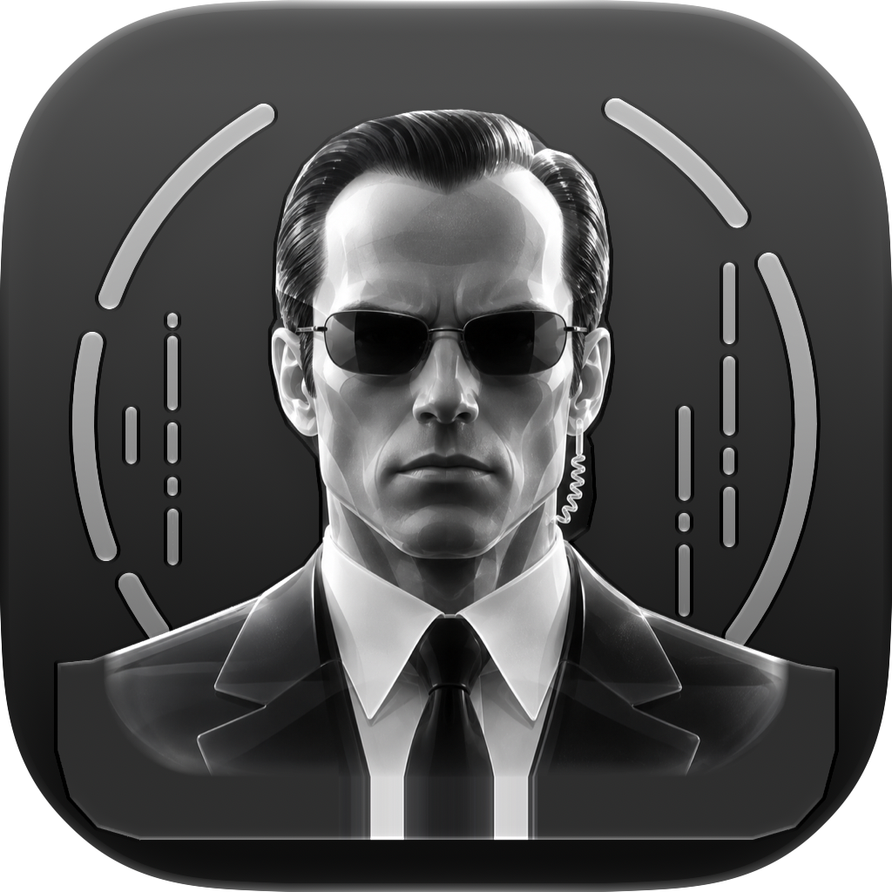
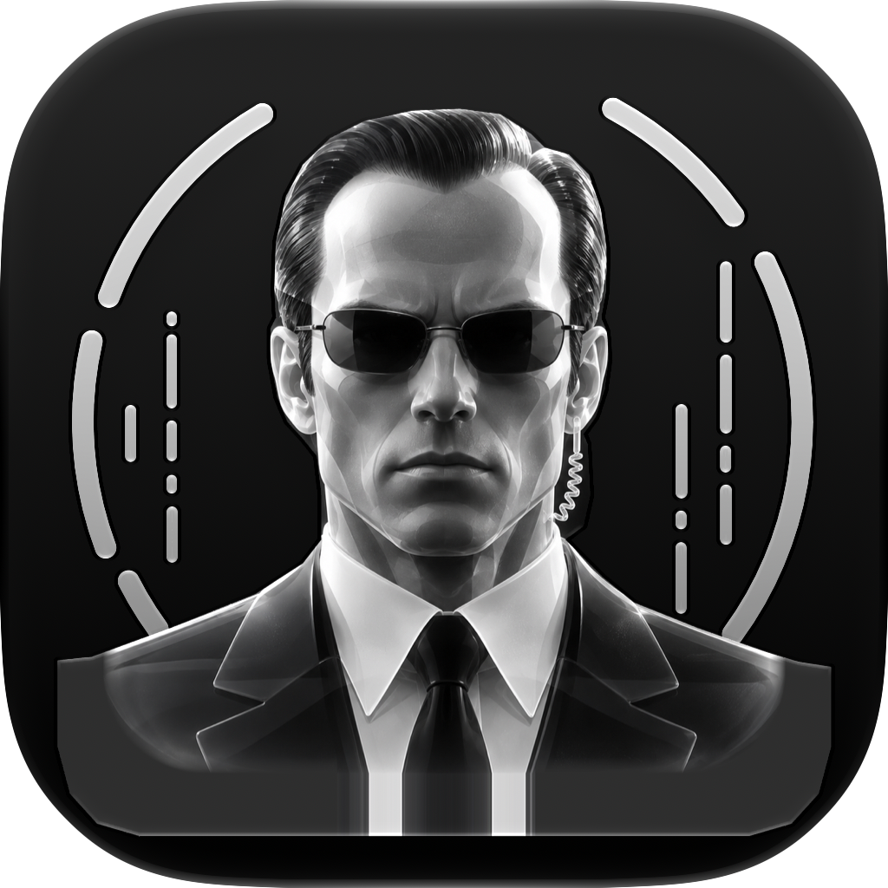

# smthz

smthz is a native **macOS 26+ (Apple Silicon)** multi-agent IDE. It is English-only, built with a SwiftUI/AppKit shell and a Swift core, and uses Liquid Glass for navigation and controls only (working content stays on flat, stable surfaces). WebKit is used only through public APIs; no Chromium.

The UI deliberately follows Orca's layout and look; the code is a separate Swift implementation. Orca is MIT-licensed (Lovecast Inc.); see [THIRD-PARTY-NOTICES.md](THIRD-PARTY-NOTICES.md).

> **Status: early development (version 0.1.0). Not usable as a daily driver.** No milestone in the roadmap is formally accepted. A large part of the UI is visual only.

## What exists today

Working and tested (unit tests with real PTYs, sockets, SQLite and Git; see the test suite in `Tests/`):

- **`smthzd`**, an execution host. It owns PTY sessions that outlive clients, journals requests in SQLite (idempotent by request id), authenticates with a same-uid unix socket plus a capability token, and closes whole process groups when it stops.
- **`smthz`**, a CLI: `ping`, `run`, `sessions`, `write`, `read`, `kill`, `attach`, `paths`. (`attach` needs a TTY and has not been verified.)
- **`SmthzCore`**, the library behind both: RPC framing, unix-socket and WebSocket transports, `HostClient`, `HostMonitor`, `GitService` (wraps `/usr/bin/git`), session environment, and UI-free shell state (layout tree, tab/pane commands, keybindings).
- **`SmthzApp`**, a SwiftUI/AppKit app: Orca-style window chrome, sidebar, tab strip, right sidebar, status bar, settings and many dialogs/menus, with real terminal emulation by [SwiftTerm](https://github.com/migueldeicaza/SwiftTerm). It connects to a running `smthzd` and shows its sessions; "New Shell" creates one.

Not done, or only a mock:

- Most screens are **visual only** (marked `VISUAL-ONLY` in the code): tasks, automations, palettes, composers, right-sidebar Agents/Checks/Ports/Explorer/Source Control, onboarding, and the "smthz Mobile" entry (there is no mobile app). They look right but have no backend. [docs/UI-WIRING.md](docs/UI-WIRING.md) lists what is real versus stubbed.
- Not started: projects/worktrees UI on top of `GitService`, editor and diffs, agent launch and provider chats, browser, own auth/relay/artifact services, SSH and remote hosts, orchestration, automations, integrations, skills/plugins, speech, computer use.
- Not verified: alternate-screen programs (vim, htop), mouse reporting, selection/Find, many hover and keyboard paths, light/dark pixel accuracy.
- The app is only ad-hoc signed; no notarized distribution or updater. Shell tabs are not yet persisted across app restarts.
- No performance comparison with Orca exists; no numbers are claimed.

## Screenshots

Taken from the real app (UI wave 4, ad-hoc build):

| | |
|---|---|
|  |  |
|  |  |

App icon (Liquid Glass, built with Icon Composer):  

More screenshots are in [docs/ui29-screenshots](docs/ui29-screenshots).

## Requirements

- macOS 26 or later, Apple Silicon.
- Xcode 27.1 (Swift 6.4). `xcode-select` may still point at the Command Line Tools; the commands below set `DEVELOPER_DIR` instead, which is required for SwiftUI macros to resolve.
- `/usr/bin/git` (used by `GitService`). The Swift Testing framework ships with the toolchain.

## Build, test, run

```sh
export DEVELOPER_DIR=/Applications/Xcode.app/Contents/Developer

swift build                      # builds SmthzCore, smthz, smthzd and SmthzApp
swift test                       # full suite

# Run the host and the CLI (short socket paths: unix sockets are limited to 104 bytes)
swift run smthzd --socket /tmp/smthz.sock &
swift run smthz ping --socket /tmp/smthz.sock
swift run smthz run --socket /tmp/smthz.sock -- /bin/sleep 30
swift run smthz sessions --socket /tmp/smthz.sock

# Build the app bundle (build/smthz.app, ad-hoc signed, icon and bundled fonts/icons)
scripts/package-app.sh           # or: scripts/package-app.sh debug
open build/smthz.app
```

`swift build` was run with these settings while preparing this README and succeeded. The `swift run` and `package-app.sh` lines are taken from the scripts and were not re-run. `--socket` goes after the subcommand. Without `--socket`, `smthzd` and the app use the default paths under Application Support (`smthz paths` prints them). To point the app at a private host: `open -n build/smthz.app --env SMTHZ_SOCKET=/tmp/smthz.sock`.

With only the Command Line Tools, `swift test` needs `-Xswiftc -plugin-path -Xswiftc /Library/Developer/CommandLineTools/usr/lib/swift/host/plugins/testing` and `SmthzApp` does not compile. Do not add a `swift-testing` package dependency.

## Architecture

```
SmthzApp (SwiftUI/AppKit, SwiftTerm)  --\
smthz (CLI)                            ---+--> SmthzCore --> unix socket (0700 dir, 0600 socket,
                                          |                  same-uid check, capability token)
smthzd (execution host)  <----------------/                  4-byte length-framed RPC, 1 MiB cap
   |-- SessionManager / PTYSession (posix_spawn, own session, process-group signals)
   |-- EventJournal (SQLite WAL, idempotent by request id + method + params hash)
   `-- HostService (ping, version, host.identity, session.*)
```

- Each execution host owns its processes and journals; the app is a client and can detach without killing sessions.
- A PID alone is never treated as process ownership (`ProcessIdentity` records the kernel start time).
- A WebSocket transport (Network.framework) carrying the same envelope exists for remote hosts; TLS/auth for it is not finished.
- Windows own presentation state; the layout tree lives in `SmthzCore` (`LayoutTree`, `ShellModel`) and is not yet bound to the app (planned in [docs/M3-PLAN.md](docs/M3-PLAN.md)).

## Repository layout

| Path | Contents |
|---|---|
| `Sources/SmthzCore` | Library: identity, journal, RPC, transports, PTY/sessions, Git, shell model |
| `Sources/smthzd`, `Sources/smthz` | Host and CLI executables |
| `Sources/SmthzApp` | SwiftUI/AppKit app (theme, sidebar, tabs, panels, dialogs, resources: Geist font, Lucide icons) |
| `Tests/SmthzCoreTests` | Swift Testing suite |
| `scripts/package-app.sh` | Builds the `.app` bundle |
| `assets/AppIcon` | Icon Composer document, layer tools, previews |
| `icon/icon.png` | Source brand artwork |
| `docs/` | Specs, plans, decisions, logs |
| `reference/` | Orca 1.4.238 source, read-only, **not** part of the published repo |

## Documentation

- [ROADMAP.md](docs/ROADMAP.md): approved product, architecture, milestones M0-M11
- [DESIGN.md](docs/DESIGN.md): native design specification
- [PARITY.md](docs/PARITY.md): Orca feature inventory and status (all "not started" rows are real)
- [UI-SPEC.md](docs/UI-SPEC.md), [UI-DETAIL.md](docs/UI-DETAIL.md), [UI-GAP.md](docs/UI-GAP.md), [UI-GAP2.md](docs/UI-GAP2.md), [UI-WIRING.md](docs/UI-WIRING.md), [UI-CHECKS.md](docs/UI-CHECKS.md): UI specification, gaps, wiring table, verification routine
- [M3-PLAN.md](docs/M3-PLAN.md): native shell work packages
- [TERMINAL-ENGINE.md](docs/TERMINAL-ENGINE.md), [TERMINAL-BEHAVIOR.md](docs/TERMINAL-BEHAVIOR.md): terminal evaluation and conformance checklist
- [ICON.md](docs/ICON.md), [ICON-RESEARCH.md](docs/ICON-RESEARCH.md): app icon
- [THIRD-PARTY-NOTICES.md](THIRD-PARTY-NOTICES.md)

## Contributing

The project is not yet open for outside contributions: the architecture and scope are still being settled and the project is moving fast. Issues describing bugs against the documented commands are welcome once the repository is public. Ground rules from the project: verify with a build and the full test suite (compare the test count; every test needs `@Test`), keep new work scoped to one bounded task, and do not change functionality parity claims without evidence ([PARITY.md](docs/PARITY.md)).

## License

MIT, see [LICENSE](LICENSE). Third-party components keep their own licenses ([THIRD-PARTY-NOTICES.md](THIRD-PARTY-NOTICES.md)). The UI follows Orca (MIT, Lovecast Inc.); no Orca state or services are used.
